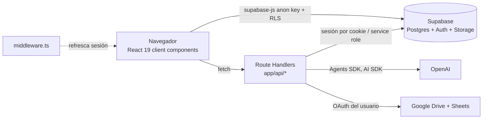
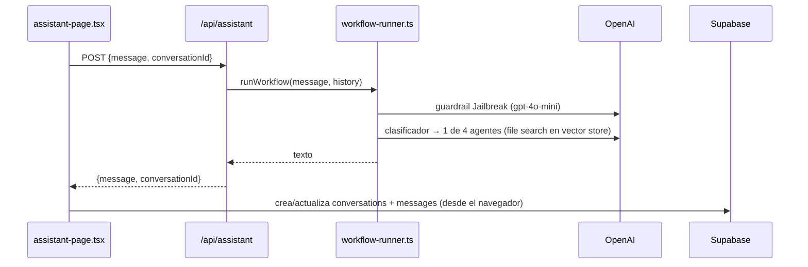

# Arquitectura técnica

Complementa la visión de producto del [README](../README.md). Aquí se describe **cómo funciona el código hoy**, con rutas a los archivos.

## Vista general



- **Next.js 16 (App Router)**. Casi todas las páginas son *client components* (`"use client"`) que leen Supabase directamente desde el navegador con la anon key. El aislamiento depende de las políticas RLS.
- **Route Handlers (`app/api/*`)**. Se usan para lo que el navegador no puede hacer: operaciones con `SUPABASE_SERVICE_ROLE_KEY` (crear e invitar usuarios, leer perfiles de otros), llamadas a OpenAI y a Google. La referencia completa está en [api.md](./api.md).
- **Despliegue**. Vercel, proyecto `evajuridico`. `main` despliega a producción y cada PR genera un preview.
- `next.config.mjs` tiene `typescript.ignoreBuildErrors: true`, así que los errores de tipos **no** rompen el build. Ejecuta `pnpm exec tsc --noEmit` antes de abrir un PR.

## Mapa de código

| Carpeta | Responsabilidad |
|---|---|
| `app/superadmin`, `app/admin`, `app/member` | Pantallas por rol. Delegan en `components/<rol>/*-page.tsx` |
| `app/login`, `app/auth/*` | Login (hay dos páginas, ver abajo), registro, callback de OAuth/magic link, cambio de contraseña |
| `app/api/*` | Backend. Ver [api.md](./api.md) |
| `lib/supabase/client.ts` / `server.ts` / `proxy.ts` | Cliente del navegador, cliente del servidor (cookies) y refresco de sesión para el middleware |
| `lib/supabase/client-data-access.ts` | Acceso a datos desde el navegador. Lo usa la mayoría de las pantallas |
| `lib/supabase/data-access.ts` | Acceso a datos desde el servidor |
| `lib/ai-chat/*` | Asistente EVA: runner de agentes, hooks, persistencia de conversaciones |
| `lib/google/*` | OAuth, Drive y Sheets |
| `lib/utils/document-generator.ts` | Rellenado de `.docx` con docxtemplater |
| `lib/impersonation-context.tsx`, `hooks/use-role-switcher.ts` | Suplantación y simulación de rol (solo en el cliente) |
| `lib/mock-data.ts` | Datos de ejemplo. **Todavía se usa** para `documentTypes`, las plantillas de prompts del asistente y el panel lateral simulado |
| `scripts/*.sql` | Migraciones manuales. Ver [base-de-datos.md](./base-de-datos.md) |

Los tipos están definidos en tres lugares que no coinciden del todo: `lib/types/database.ts`, la cabecera de `lib/supabase/data-access.ts` y `lib/mock-data.ts`. **No son tipos generados** desde Supabase.

## Autenticación, roles y onboarding

**Sesión.** La gestiona Supabase Auth con cookies (`@supabase/ssr`). `middleware.ts` → `lib/supabase/proxy.ts` refresca la sesión y redirige a `/login` si no hay usuario en `/superadmin`, `/admin`, `/member` o `/dashboard`. **No valida rol ni estado.** Esas comprobaciones las hacen las propias páginas en el cliente y las rutas API.

**Roles.** El rol vive en `profiles.role` (`superadmin` | `admin` | `member`) y el tenant en `profiles.organization_id`.

**Flujos de entrada:**

1. **Registro** (`app/auth/sign-up`). Usa `supabase.auth.signUp` con metadata `{name, role, organization_id}`. El trigger `handle_new_user` (`scripts/026`) crea el perfil con `status = 'pending'`.
2. **Aprobación.** El superadmin la hace en `/superadmin/pending-users` (`/api/pending-users` y `/api/update-user-status`).
3. **Invitación.**
   - El superadmin usa `/api/send-invitation`.
   - El admin y el superadmin usan `/api/create-member`.
   - En ambos casos se emplea `auth.admin.inviteUserByEmail` o `generateLink`. El correo sale por el **SMTP configurado en Supabase Auth**; el código no llama a Brevo directamente.
   - El enlace lleva a `/auth/update-password?invite=true&org=…`.
4. **Login** (`app/login` y `app/auth/login`, duplicadas). Ofrece contraseña o Google (OAuth vía Supabase). Tras autenticar se lee `profiles.status`: si no es `approved`, se cierra la sesión. Si lo es, se redirige según el rol.
5. **Callback** (`app/auth/callback/page.tsx`, client component). Procesa el hash, crea o actualiza el perfil si hace falta y redirige.

**Suplantación.** El superadmin elige una organización y se guarda en `localStorage.eva_impersonation`. `hooks/use-profile.ts` sobrescribe `organization_id` y `role` en el estado de React. **El servidor no sabe nada de la suplantación**: las consultas siguen ejecutándose con los permisos reales del superadmin.

## Asistente jurídico EVA



- `lib/ai-chat/workflow-runner.ts` es una **reimplementación local** con `@openai/agents` del workflow diseñado en OpenAI Agent Builder. El workflow alojado no se ejecuta: `OPENAI_ASSISTANT_WORKFLOW_ID` solo se envía como metadata de traza.
- Los cuatro agentes son `process_guidance`, `contract_consultation`, `legal_research` y `general_information`. Los dos últimos usan `fileSearchTool` sobre `OPENAI_VECTOR_STORE_ID`. El modelo `gpt-4o-mini` está fijo en el código.
- **Sin streaming**: la respuesta llega completa en JSON.
- La persistencia la hace el navegador (`lib/ai-chat/use-conversations.ts` → `services/conversations-api.ts`) en las tablas `conversations` y `messages`. No se usan Threads de OpenAI; `openai_thread_id` guarda el mismo id de la conversación.
- **Limitación conocida:** el servidor intenta leer el historial con un cliente de navegador, sin cookies. Con RLS no obtiene filas, así que hoy **cada turno llega al modelo sin contexto**.
- Otras rutas de IA:
  - `/api/improve-text` (AI SDK, `gpt-4o`): el botón "mejorar texto" de `generate-documents-dialog.tsx`.
  - `/api/chat`: usa streaming, pero ninguna pantalla la llama.
  - `components/member/ai-assistant.tsx`: el panel del dashboard; es un **mock** y no llama a ninguna API.

## Plantillas y generación de documentos

```mermaid
flowchart TD
  SA[Superadmin sube .docx] -->|mammoth extrae {{VARIABLES}}| T[(templates.variables)]
  SA -->|/api/upload-template| D1[Drive del superadmin<br/>plantillas/&lt;tipo&gt;/]
  M[Miembro completa variables] -->|/api/generate-document| GEN[docxtemplater + logo]
  D1 -->|descarga con token del miembro| GEN
  GEN --> D2[Drive del miembro<br/>plantillas/&lt;código proceso&gt;/]
  GEN --> S[Hoja &lt;código proceso&gt; pestaña Documentos]
  GEN --> DOC[(documents, status draft)]
```

- **Google usa solo OAuth por usuario**: no hay Service Account en el código. `/api/google/auth` devuelve la URL de consentimiento (scopes `drive` y `spreadsheets`, offline). `/api/google/callback` guarda los tokens en `google_oauth_tokens` y `lib/google/oauth.ts` los refresca.
- Las etiquetas de las plantillas siguen el formato `{{NOMBRE_VARIABLE}}` (regex `[A-Z_][A-Z0-9_]*` en `lib/utils/template-helpers.ts`). El sistema agrega `ENTIDAD`, `SECRETARIA` y `LOGO_ENTIDAD` (imagen de `entities.logo_url`).
- `templates.file_url` se guarda como `fileId:<id>|path:<ruta en Drive>`.
- Si `GOOGLE_DRIVE_ID` no está definido, los archivos se comparten como "cualquiera con el enlace" para que otros usuarios puedan leer la plantilla.
- `lib/google/cache.ts` mantiene caché y locks **en memoria**. No se comparten entre instancias serverless.
- Los logos de las entidades van al bucket público `entity-logos` de Supabase Storage (`/api/upload-logo`).

## Variables de entorno

La lista completa con comentarios está en [`.env.example`](../.env.example).

Variables que existen en Vercel pero **el código no lee**: `BREVO_*`, `EVA_MCP_*`, `NEXT_PUBLIC_SUPABASE_PUBLISHABLE_KEY`, `GOOGLE_SERVICE_ACCOUNT_*`, `GOOGLE_PROJECT_ID`, `GOOGLE_DRIVE_TIMEOUT_MS`, `GOOGLE_DRIVE_FOLDER_ID` (casi sin uso), `OPENAI_MODEL`, `OPENAI_WORKFLOW_MODEL` y `*_MAX_DURATION`. Los `maxDuration` están fijos en cada ruta.

## Deuda técnica conocida (no relacionada con seguridad)

- Hay dos páginas de login (`app/login` y `app/auth/login`). El middleware redirige a la primera y los callbacks a la segunda.
- La columna `profiles.full_name` se usa en el código pero no existe en el esquema (por ejemplo, `client-data-access.ts` la usa en un `order`).
- `processes.code` es único **global**, pero `generateProcessCode` solo ve los códigos de su organización, así que pueden aparecer colisiones entre tenants.
- El refresco del token de Google falla cuando Google no devuelve un `refresh_token` nuevo y además llama a `.getTime()` sobre un número (`lib/google/oauth.ts`). En la práctica obliga a reconectar Google.
- Con `GOOGLE_DRIVE_ID` definido, la búsqueda de la carpeta raíz no encuentra resultados y la crea en My Drive en cada *cold start*.
- `improve-text.ts` pasa `maxTokens`; en AI SDK v5 el parámetro es `maxOutputTokens`, así que el límite se ignora.
- `listUsers()` se llama sin paginación (solo devuelve los primeros 50 usuarios).
