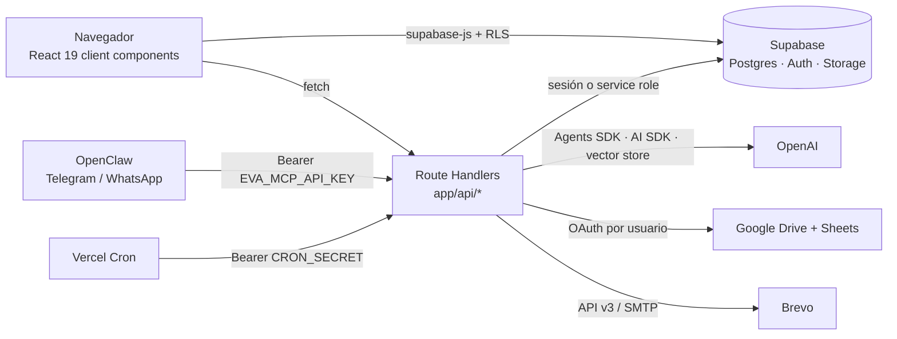
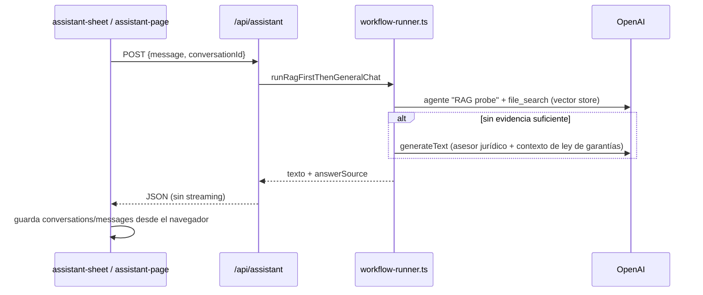

# Arquitectura técnica

Describe **cómo funciona el código hoy** en `develop`, con rutas a los archivos. La visión de producto está en el [README](../README.md) y los requisitos en [`docs/mvp/`](./mvp/).

## Vista general

- **Next.js 16 (App Router)**. Casi todas las pantallas son *client components* que leen Supabase directamente con la anon key. Lo que el navegador no puede hacer pasa por `app/api/*`: operaciones con `SUPABASE_SERVICE_ROLE_KEY`, IA, Google, correo y auditoría. Ver [api.md](./api.md).
- **Supabase**: Postgres con RLS (ver [base-de-datos.md](./base-de-datos.md)), Auth con correo/contraseña y Google, y Storage (bucket `entity-logos`).
- **Despliegue**: Vercel, proyecto `evajuridico`. Ver *Entornos* en [onboarding.md](./onboarding.md).
- `next.config.mjs` tiene `typescript.ignoreBuildErrors: true`: los errores de tipos no rompen el build. Ejecuta `pnpm exec tsc --noEmit` antes de abrir un PR.

## Roles

| Rol | Cómo se identifica | Entra a (`lib/auth/home-path.ts`) | Alcance |
|---|---|---|---|
| Superadmin de plataforma | `role = 'superadmin'` y `organization_id IS NULL` | `/superadmin` | Todas las organizaciones |
| Superadmin de organización | `role = 'superadmin'` con `organization_id` | `/superadmin/process-types` | Tipos de proceso, plantillas, ley de garantías, entidades y miembros de su organización |
| Admin | `role = 'admin'` | `/admin` | Su organización |
| Asesor (member) | `role = 'member'` | `/member` | Su organización; la UI filtra por entidades asignadas (`member_entities`) |
| Contacto de entidad | `role = 'entity_contact'` + `profiles.entity_id` | `/member/messages` | Hilos de mensajes de los procesos de su entidad |

Helpers: `lib/auth/superadmin-scope.ts` (`isPlatformSuperadmin`, `isOrgSuperadmin`) en TypeScript; `is_platform_superadmin`, `is_org_superadmin` y `can_access_organization` en SQL (script 043).

`profiles.status` (`pending` / `approved` / `rejected`) solo lo comprueban las pantallas de login y la API MCP. El middleware, las rutas API y RLS no lo tienen en cuenta.

## Autenticación y onboarding

- **Sesión**: cookies de Supabase (`@supabase/ssr`).
  - `middleware.ts` → `lib/supabase/proxy.ts` refresca la sesión y redirige a `/login` si no hay usuario en `/superadmin`, `/admin`, `/member` o `/dashboard`.
  - **No valida rol ni estado.** Las guardas de rol de las pantallas son de cliente (`app/member/layout.tsx`, `app/admin/layout.tsx`).
- **Login**: hay dos páginas casi iguales, `app/login` (destino del middleware) y `app/auth/login`. Ambas usan `signInWithPassword` o Google OAuth vía Supabase. Si `status ≠ approved`, cierran la sesión; si no, redirigen con `homePathForRole`.
- **Registro**: `app/auth/sign-up` llama a `signUp` con metadata `{name, role, organization_id}`. El trigger `handle_new_user` (script 026) crea el perfil `pending`.
- **Callback**: `app/auth/callback/page.tsx` (cliente). Establece la sesión desde el hash, crea o completa el perfil si hace falta y audita el login.
- **Contraseña e invitaciones**:
  - `app/auth/forgot-password` → `app/auth/update-password`, que también recibe las invitaciones (`?invite=true&org=`).
  - Las invitaciones salen de `/api/create-member` y `/api/send-invitation` (`auth.admin.generateLink` / `inviteUserByEmail`).
  - Los correos de Auth usan el SMTP configurado en Supabase ([supabase-smtp-config.md](./supabase-smtp-config.md)).
- **Aprobación**: `/superadmin/pending-users` (`/api/pending-users`, `/api/update-user-status`).
- **Suplantación y simulación de rol**: solo en la UI (`lib/impersonation-context.tsx`, `hooks/use-role-switcher.ts`, en `localStorage`). El servidor siempre usa el perfil real.

## Asistente de IA

- **Modelos**: `lib/ai-model-config.ts` lee `OPENAI_MODEL` (por defecto `gpt-4o`), `OPENAI_WORKFLOW_MODEL` y `ASESOR_JURIDICO_*`. Omite `temperature` en modelos o* y gpt-5.
- **Guardrails** (Jailbreak, PII) con `@openai/guardrails` en `runWorkflow`.
- **RAG**:
  - Hay un único vector store, `OPENAI_VECTOR_STORE_ID`, **compartido por todas las organizaciones**.
  - Al aprobar un documento, `/api/update-document` lo ingesta (`lib/rag/ingest.ts`).
- **Ley de garantías**: `lib/guarantee-law/eva-context.ts` inyecta los periodos de la organización y, si el mensaje cita códigos de proceso, sus etapas.
- **Otras rutas**:
  - `/api/improve-text` y `/api/ask-simple`: los usa `generate-documents-dialog.tsx`.
  - `/api/smart-fill-fields` (SPEC-004): `lib/smart-fill/runner.ts`, reutilizado por la API MCP.
  - `/api/document-assistant` (SPEC-002): API implementada, pero el diálogo no está montado.
  - `/api/chat`: streaming, sin consumidor en la UI.
- **Persistencia**: tablas `conversations` y `messages`, escritas desde el navegador (`lib/ai-chat/services/conversations-api.ts`). Ver `lib/ai-chat/PERSISTENCE.md`.
  - **Limitación conocida**: `/api/assistant` lee el historial con un cliente de navegador sin sesión, así que el modelo no recibe el contexto de turnos anteriores.

## Plantillas y documentos

- **Plantillas** (`templates`):
  - Pueden ser globales, de una organización (`organization_id`, script 043) o de una entidad (`entity_id`, script 031).
  - Se relacionan con tipos de proceso N:M (`template_process_types`).
  - Las sube un superadmin a Drive (`/api/upload-template`); las variables `{{VAR}}` se validan con `/api/templates/validate`.
- **Generación** (`/api/generate-document`):
  1. Descarga la plantilla.
  2. Aplica docxtemplater (`lib/utils/document-generator.ts`, `template-helpers.ts`: imágenes y tablas dinámicas).
  3. Sube el resultado a Drive en `procesos/<código>`.
  4. Inserta `documents` con versión N+1 y estado `draft`.
  5. Agrega una fila en Google Sheets.
  6. Pasa el proceso a `in_progress` y guarda `process_field_values`.
  - La API MCP usa una copia de esta lógica en `lib/document-generation/generate-single.ts` y `generate-batch.ts`.
- **Google**: OAuth por usuario (`lib/google/oauth.ts`, tabla `google_oauth_tokens`). La raíz es `GOOGLE_DRIVE_ID` (Shared Drive) o `GOOGLE_DRIVE_FOLDER_ID`. Sin Shared Drive, los archivos se comparten como "cualquiera con el enlace".
- **Estados de documento**: `draft → pending → in_review → approved / rejected` (script 029).
  - El asesor envía a revisión; el admin aprueba o rechaza (`/api/update-document`).
  - Cada cambio queda en `document_audit_log` y `audit_log`.
- **Adjuntos**: `/api/process-attachments` (Drive + `process_attachments`).
- **Valores de campos**: `/api/processes/[id]/fields`, `fields/confirm` y `reuse` (`process_field_values`).

## Ciclo de vida del proceso

- **Creación**: desde el navegador (`lib/supabase/client-data-access.ts`, `create-process-dialog.tsx`). Estado vía `/api/update-process`; borrado vía `DELETE /api/processes/[id]`.
- **Etapas SECOP** (`process_stages`, script 040): publicación, observaciones, adjudicación, firma, garantías e inicio. `/api/processes/[id]/stages` avisa si el orden de fechas es incoherente o si una fecha cae en un periodo de ley de garantías.
- **Alertas**: `/api/cron/stage-alerts` corre a diario a las 12:00 UTC (7:00 en Colombia). Avisa 3 días y 1 día antes del vencimiento, por notificación in-app y correo. Es idempotente gracias a `stage_alerts_sent`.
- **Asignación**: `/api/processes/[id]/assign` (`assigned_to`). Da acceso a la entidad, notifica y envía correo.
- **Hilo de mensajes**: `/api/processes/[id]/messages` y la bandeja `/api/messages`. La tabla `process_messages` es inalterable (trigger) y el contacto de entidad participa en ella.
- **Notificaciones**: tabla `notifications`, `/api/notifications`, `components/member/notifications-bell.tsx`.
- **Correo**: `lib/email/brevo.ts`, por API v3 o por SMTP si la clave empieza por `xsmtpsib-`. `sendEmailToUserIds` nunca lanza error; los fallos se auditan como `email_failed`.
- **Entidades**: un miembro las propone y un admin las aprueba o rechaza; también se pueden fusionar (`/api/entities/*`, script 041).

## Canales externos (API "MCP", SPEC-005)

No es un servidor MCP real, sino una API HTTP que consume el bot OpenClaw ([openclaw/](./openclaw/)).

- **Autenticación**: `Authorization: Bearer EVA_MCP_API_KEY` (`lib/mcp/auth.ts`). Todas las operaciones usan service role.
- **Identidad**: `channel` + `externalUserId` en `channel_user_links`. Si no hay vínculo, se busca por teléfono en `profiles.phone`. El perfil debe estar `approved` (`lib/mcp/resolve-user.ts`).
- **Endpoints**: `link-user`, `ask`, `entities`, `processes`, `processes/[id]` y `generate-smart` (`lib/mcp/orchestrate.ts`). Este último crea el proceso, ejecuta smart-fill y genera documentos con los tokens de Google de `EVA_MCP_INTEGRATION_USER_ID`.

## Auditoría

- `audit_log` (script 038) es **inalterable**: un trigger rechaza UPDATE y DELETE.
  - En el servidor se escribe con `lib/audit/log.ts`; desde el cliente, con `/api/audit/log`, que tiene una lista blanca de acciones.
  - Se consulta con `/api/audit` (JSON o CSV) en `/admin/audit` y `/member/audit`.
- `document_audit_log` guarda solo las transiciones de estado de documentos.
- **Efecto secundario conocido**: las FKs de `audit_log` y `process_messages` usan `ON DELETE SET NULL` / `CASCADE`, que el trigger rechaza. Por eso borrar un proceso, documento o perfil con historial puede fallar.

## Cron

`vercel.json` define:

| Ruta | Horario (UTC) | Qué hace |
|---|---|---|
| `/api/cron/reconcile-drive` | 07:00 | Lista archivos de Drive sin registro en la BD (solo devuelve el resultado, no lo guarda) |
| `/api/cron/stage-alerts` | 12:00 | Alertas de vencimiento de etapas |

Autenticación: `Bearer CRON_SECRET` (o sesión de superadmin, para ejecutarlo a mano).

## Deuda técnica

- Dos páginas de login (`app/login`, `app/auth/login`).
- Cliente service role creado en línea en unas 30 rutas, en vez de un helper común. Las comprobaciones de rol se repiten a mano y no siempre usan `lib/auth/superadmin-scope.ts`.
- Lógica de generación duplicada entre `/api/generate-document` y `lib/document-generation/*`.
- Código sin uso: `/api/chat`, `components/member/ai-assistant.tsx`, `document-assistant-dialog.tsx`, `lib/mock-data.ts` (parcial).
- `lib/types/database.ts` no tiene tipos para 14 de las 25 tablas, y varios tipos están desactualizados.
- `next.config.mjs` con `ignoreBuildErrors: true`; sin tests automatizados.
