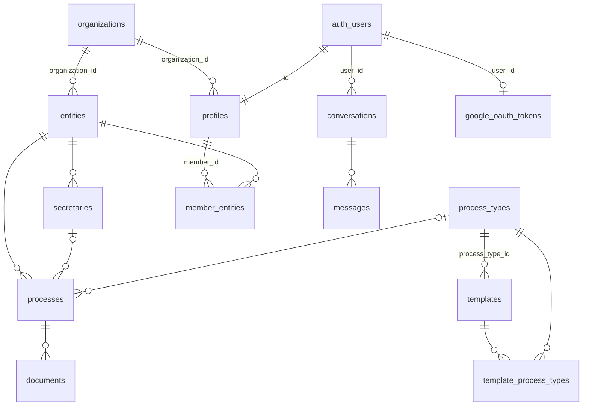

# Base de datos (Supabase / PostgreSQL)

El esquema se construyó aplicando a mano los scripts de `scripts/` en el SQL Editor de Supabase. **No hay herramienta de migraciones** (ni Supabase CLI ni Prisma), y varios scripts son intentos sucesivos de corregir RLS que se pisan entre sí. Este documento describe el **resultado** de aplicarlos.

> Lo descrito se dedujo leyendo los scripts. Antes de asumirlo en una base existente, compáralo con el esquema real (*Supabase → Database → Tables / Policies*).

## Modelo de datos



| Tabla | Propósito | Columnas relevantes |
|---|---|---|
| `profiles` | Un perfil por usuario de Auth | `role` (`superadmin`/`admin`/`member`), `organization_id`, `status` (`pending`/`approved`/`rejected`, script 023) |
| `organizations` | Tenant (firma jurídica) | `nit` único, `status` (`active`/`inactive`) |
| `entities` | Cliente de la organización (alcaldía, etc.) | `organization_id` (NOT NULL), `logo_url`, `representative_name` |
| `secretaries` | Dependencia de una entidad | `name` (secretaría), `secretary_name` (persona) |
| `process_types` | Catálogo **global** de tipos de proceso | — |
| `templates` | Plantilla `.docx` | `process_type_id`, `file_url` (`fileId:…\|path:…`), `variables` JSONB (014) |
| `template_process_types` | Relación M:N plantilla ↔ tipo de proceso (019) | — |
| `processes` | Expediente de contratación | `code` (**único global**), `status` (`draft`/`in_progress`/`review`/`completed`/`archived`), `spreadsheet_*` (015), `drive_folder_*` (017) |
| `documents` | Documento generado | `status` (`draft`/`pending`/`approved`/`rejected`), `version`, `file_url` |
| `member_entities` | Entidades asignadas a un miembro (022) | `member_id`, `entity_id` |
| `conversations`, `messages` | Historial del asistente (011, 013) | `messages.sequence_order` único por conversación |
| `google_oauth_tokens` | Tokens OAuth de Google por usuario (016) | `user_id` único |
| `chat_messages` | **Legado, sin uso** | — |

También se crearon las vistas `organization_stats` y `entity_process_stats` (003). Ningún código las usa.

**Storage**: bucket público `entity-logos` (018), límite de 5 MB, solo imágenes.

## Funciones y triggers

- **`handle_new_user()`**: trigger `AFTER INSERT ON auth.users`. Crea el perfil con `name`, `role` y `organization_id` tomados de `raw_user_meta_data`, y `status = 'pending'`. La versión vigente es la del script 026. Si falla, el error se registra como `WARNING` y el usuario queda **sin perfil**.
- **`update_updated_at_column()`**: actualiza `updated_at` en casi todas las tablas.
- **`public.get_user_role(uuid)`** y **`public.get_user_org(uuid)`**: funciones `SECURITY DEFINER` que usan las políticas RLS (script 012).

## Modelo multi-tenant

- El **tenant es la organización**. Un usuario pertenece a una sola, vía `profiles.organization_id`.
- `entities.organization_id` es la raíz del aislamiento. `secretaries`, `processes` y `documents` heredan el tenant a través de `entity_id` (las políticas usan `EXISTS` sobre `entities`).
- `process_types` y `templates` son catálogos globales; solo el superadmin los modifica.
- `conversations` y `google_oauth_tokens` pertenecen al usuario (`auth.uid() = user_id`).
- **`member_entities` solo se aplica en la UI**: filtra qué entidades ve el miembro. RLS aísla por organización, no por entidad asignada.
- **`profiles.status` solo lo comprueban las pantallas de login.** Ninguna política RLS lo tiene en cuenta.
- Leer los perfiles de otros usuarios del mismo tenant requiere service role. Por eso existen las rutas `/api/get-organization-members` y similares.

## Scripts: qué hace cada uno

| Script | Tipo | ¿Aplicar en una BD nueva? |
|---|---|---|
| 001 create-tables | Esquema base | ✔ |
| 002, 005, 006, 008, 009, 010, 011-disable-profiles-rls, 012 | Iteraciones de RLS | Solo como referencia (ver abajo) |
| 003 / 003-safe | Funciones, triggers, vistas (son idénticos) | Solo uno |
| 004, 007 | Seeds de demo | ✘ (usan IDs que no son UUID y fallan) |
| 011-create-conversations, 013 | Asistente | ✔ |
| 014, 015, 017, 019, 022, 023 | Columnas y tablas nuevas | ✔ |
| 016 | `google_oauth_tokens` | ✔ |
| 018 | Bucket de storage | ✔ |
| 020, 021, 025 | Políticas puntuales | Revisar |
| 024, 027 | Consultas de diagnóstico | ✘ |
| 026 | Versión final de `handle_new_user` | ✔ |

**Problemas de orden y compatibilidad:**

- 003 inserta `profiles.status`, pero esa columna no existe hasta 023.
- 005–010 y 020 crean funciones en el schema `auth`. Los proyectos de Supabase recientes no lo permiten.
- 009 y 010 redefinen y luego eliminan `auth.role()`, que es una función nativa de Supabase. **No los ejecutes.**
- 011-disable-profiles-rls hace `DROP FUNCTION` sin `CASCADE` sobre una función con dependencias, así que falla. El estado real de RLS en `profiles` depende de cómo se aplicó históricamente.
- 023 aprueba en bloque a todos los usuarios existentes.
- Varios scripts no son idempotentes: `CREATE TRIGGER` / `CREATE POLICY` sin `DROP … IF EXISTS`.

## Recomendación para la nueva BD

Al crear la nueva base de datos, **no repitas la secuencia 001–027**. En su lugar:

1. Exporta el esquema real de la base actual:
   ```bash
   supabase db dump --schema public > schema.sql
   ```
   Si no tienes la CLI, usa `pg_dump --schema-only`.
2. Revísalo y consolídalo en una migración inicial versionada (`supabase/migrations/0001_init.sql`) con la Supabase CLI. Incluye una sola versión limpia de las políticas RLS.
3. Escribe seeds nuevos con UUID válidos.
4. Desde ahí, aplica todo cambio de esquema como una migración nueva dentro de un PR.
