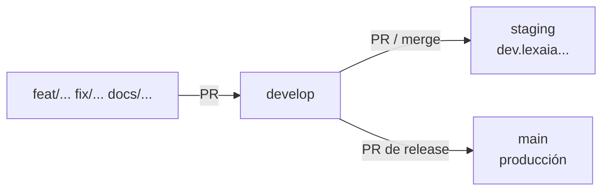

# Onboarding: entorno local y flujo de trabajo

Objetivo: tener la app corriendo en `http://localhost:3000` contra la base de datos de **desarrollo** en menos de 15 minutos.

## Entornos

| Entorno | URL | Rama | Supabase | Datos |
|---|---|---|---|---|
| Local | `http://localhost:3000` | la tuya | `lexia-dev` | De prueba |
| Previews de PR | `*-miguel-4089s-projects.vercel.app` | cualquier rama | `lexia-dev` | De prueba |
| Staging | `https://dev.lexaia.huntersolutions.tech` | `staging` | `lexia-dev` | De prueba |
| Producción | `https://lexaia.huntersolutions.tech` | `main` | producción | **Reales** |

Las variables de Vercel están separadas por entorno: *Preview* apunta a `lexia-dev` y *Production* a la base de producción.

## Flujo de ramas (obligatorio)



- **Nunca** hagas commit ni push directo a `main` ni a `develop`. Todo entra por Pull Request.
- Crea tu rama desde `develop` y abre el PR hacia `develop`:
  ```bash
  git switch -c feat/descripcion-corta origin/develop
  ```
  ```bash
  gh pr create --base develop
  ```
- Para probar en el dominio fijo, lleva `develop` (o tu rama) a `staging`.
- Las publicaciones a producción son PRs de `develop` → `main`.

Hooks locales recomendados (no se versionan) para evitar un push accidental:

```bash
cat > .git/hooks/pre-push <<'EOF'
#!/bin/sh
while read l ls r rs; do
  case "$r" in refs/heads/main|refs/heads/develop|refs/heads/master) echo "Push directo bloqueado. Abre un PR." >&2; exit 1 ;; esac
done
EOF
chmod +x .git/hooks/pre-push
```

## 1. Requisitos

- Node.js 22+ (Vercel usa 24.x) y pnpm 10+ (`corepack enable pnpm`).
- Vercel CLI (`npm i -g vercel`) para descargar variables.
- Acceso al repositorio en GitHub, al proyecto `evajuridico` de Vercel y al proyecto `lexia-dev` de Supabase.

## 2. Variables de entorno

```bash
vercel link --project evajuridico
```

```bash
vercel env pull .env.local --environment=preview
```

Así obtienes los valores de **desarrollo**. Después:

- **Variables marcadas como *Sensitive* en Vercel**: llegan vacías. Cópialas a mano en `.env.local`.
  - Las de Supabase dev (`NEXT_PUBLIC_SUPABASE_ANON_KEY`, `SUPABASE_SERVICE_ROLE_KEY`) están en Supabase → `lexia-dev` → *Project Settings → API Keys → Legacy API keys*.
  - `OPENAI_API_KEY` la tiene quien administra la cuenta de OpenAI.
- **URLs**: cámbialas a localhost.
  ```env
  NEXT_PUBLIC_APP_URL="http://localhost:3000"
  GOOGLE_REDIRECT_URI="http://localhost:3000/api/google/callback"
  ```
- **No uses las credenciales de producción en local.**

Referencia completa: [env-config.md](./env-config.md) y [`.env.example`](../.env.example).

## 3. Instalar y correr

```bash
pnpm install
```

```bash
pnpm dev
```

pnpm 10+ bloquea los scripts de instalación de dependencias nativas. Si falla `@tailwindcss/oxide` o `sharp`, ejecuta `pnpm approve-builds`.

Antes de abrir un PR:

```bash
pnpm exec tsc --noEmit
```

## 4. Usuarios de prueba

La base `lexia-dev` tiene organizaciones, entidades, procesos y un usuario por rol (`superadmin@lexia.test`, `superadmin.andino@lexia.test`, `admin@lexia.test`, `asesor@lexia.test`, `contacto@lexia.test`, etc.). Pide la contraseña de desarrollo a quien administre el entorno.

## 5. Configuración externa

- **Supabase `lexia-dev` → Authentication → URL Configuration**: Site URL `https://dev.lexaia.huntersolutions.tech`. Redirect URLs: `http://localhost:3000/**`, `https://dev.lexaia.huntersolutions.tech/**` y `https://*-miguel-4089s-projects.vercel.app/**`.
- **Google Cloud → OAuth client**: los *redirect URIs* `http://localhost:3000/api/google/callback` y `https://dev.lexaia.huntersolutions.tech/api/google/callback`.
- La tabla `google_oauth_tokens` es independiente en cada base: en desarrollo cada usuario debe conectar su Google Drive. **Los archivos de Drive sí son reales**: usa una carpeta o Shared Drive de pruebas (`GOOGLE_DRIVE_ID`).

## 6. Cambios de base de datos

1. Escribe el script siguiente en `scripts/` (por ejemplo `046-…sql`), idempotente.
2. Pruébalo en `lexia-dev`.
3. Inclúyelo en el PR.
4. Tras el merge, quien tenga acceso lo aplica en producción desde el SQL Editor.

Detalles en [base-de-datos.md](./base-de-datos.md).

## Siguientes lecturas

- [arquitectura.md](./arquitectura.md): cómo funciona cada parte.
- [api.md](./api.md): las rutas de `app/api`.
- [`docs/mvp/`](./mvp/): requisitos funcionales.
